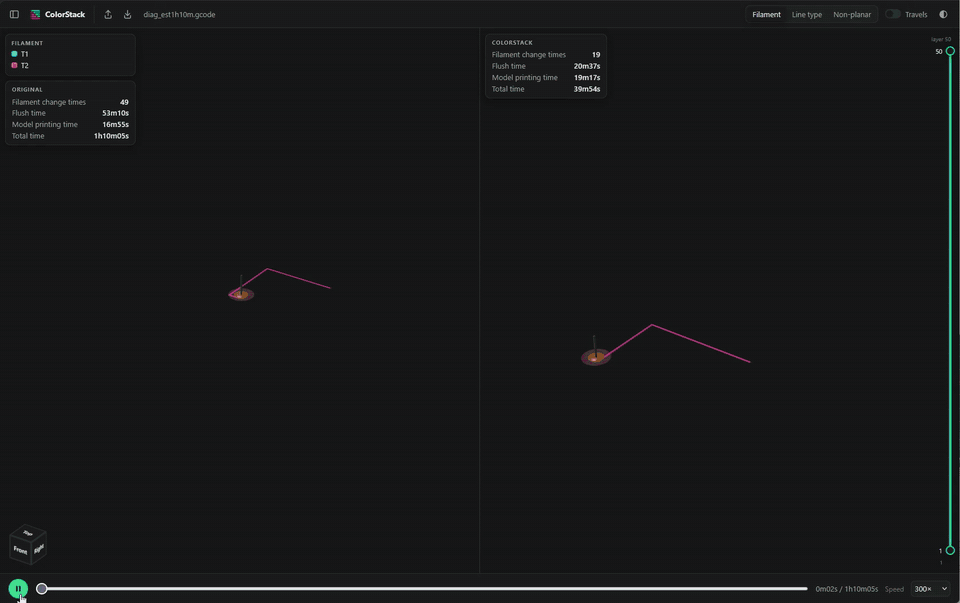

# ColorStack

A multicolour print normally swaps filament on every layer that has more than one colour. <br>ColorStack rewrites the
sliced G-code so each colour prints several layers in one go (Color Batching), wherever the nozzle can do so
without colliding. <br>Fewer swaps = less purge waste, shorter prints.



*Example test cube: <br> Unprocessed file - 49 colour changes, 1h10m estimated print time <br> ColorStack - 19 colour changes, 40m estimated print time*

## Install
Download the zip for your system from [Releases](https://github.com/shawn-makes-stuff/ColorStack/releases), unpack it
anywhere and run `color-batching-app`. The app opens in your browser at http://127.0.0.1:8765. Keep the `viewer`
folder next to the program; your settings are saved beside it in `colorstack.toml`.

- macOS: the build is not signed. The first time, right-click the app and choose Open (or run
  `xattr -d com.apple.quarantine color-batching-app`).
- Linux: `chmod +x color-batching color-batching-app` if the zip lost the permissions.

## Quick start
1. **Slice** your multicolour model as usual and export the G-code.
2. **Import** it in the app (top bar), press **Optimize file**, and check the two prints side by side.
3. **Export** the optimized file, or send it straight to a Moonraker printer.

The defaults suit a standard 0.4 mm nozzle. The setting that matters most is **Edge contact** (0.2 mm): how much
taller a neighbouring colour may stand while the nozzle passes it, at 0.2 mm layers that lets each colour print two
layers at a time. 0.0 turns batching almost off; higher values batch more but are not print-tested yet. The other
nozzle numbers (tip diameter, cone angle, clear height) change little at 0.2; if you raise edge contact, measure
them first:
- **Tip diameter**: the flat face at the very tip (calipers, or a close-up photo next to a ruler).
- **Cone angle**: the nozzle's taper measured from vertical (half the full cone angle), from a side photo.
- **Clear height**: how far the tip sticks out below the heater block, silicone sock or fan duct.

Prefer the command line? `color-batching in.gcode -o out.gcode` uses the same saved settings
(`--set section.key=value` overrides one, e.g. `--set nozzle.cone_angle=40`).

All settings are described in [docs/settings.md](docs/settings.md).

## What it handles
- Made for OrcaSlicer G-code from single-nozzle printers with a filament changer (tested on an Anycubic Kobra 3 with
  ACE, and Elegoo / Anycubic profiles). PrusaSlicer files are read, with some of its settings not yet followed.
- A line is never printed under plastic of another colour that is already there; the slicer's speeds, flow, pressure
  advance, retraction, temperatures and fans are kept per line.
- The prime tower keeps the size and place the slicer gave it. When the slicer puts each colour pair's flush into the
  tower (purge in prime tower), every swap that is left still gets its own pair's flush there, as far as the tower
  allows; the command line reports any swap that falls short.
- Refused: two or more nozzles, belt printers, sequential (object by object) printing, and files ColorStack already
  processed (each output carries a "Processed by ColorStack" comment).
- Not yet: Bambu AMS and Prusa MMU swap routines written as moves.

## Building from source
CMake 3.20 and a C++17 compiler:
```
cmake -S cpp -B cpp/build -DCMAKE_BUILD_TYPE=Release
cmake --build cpp/build --config Release
```
The programs land in `cpp/build/Release` (Windows) or `cpp/build`. The Python package in `colorstack/`
(`pip install numpy scipy`, `python -m colorstack.app`) is the reference the C++ build is checked against: both
write byte-identical files.

## Credit
Builds on the idea of interlayer tool clustering from A. Petsiuk, B. Bloch, D. Vogt, M. Debora and J. M. Pearce,
"Tool change reduction for multicolor fused filament fabrication through interlayer tool clustering implemented
in PrusaSlicer", Rapid Prototyping Journal 30(8), 1592-1609, 2024 (doi:10.1108/RPJ-01-2024-0050).
